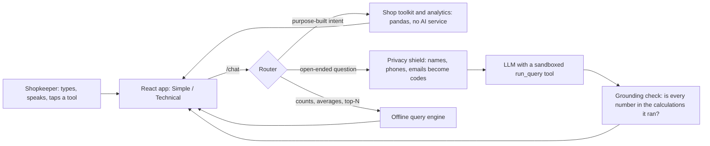

# PredictWise AI: architecture and engineering decisions

## How a question flows

Private mode skips the AI branch entirely. Every answer can show the calculations behind it.

## Layers

| Layer | Modules | Idea |
|---|---|---|
| AutoML | `automl`, `cleaning`, `eda` | One pipeline per candidate; ranked on cross-validation, scored once on rows never used to choose |
| Trust | `trust`, `calibration` | Out-of-range guard, exact Shapley explanations, what-if, fairness audit, and a *tested* range or track record on every prediction |
| Forecasting | `forecast`, `validation` | Several methods replayed over the shop's past weeks; the best is chosen by replay error; orders are sized to a service level and checked on weeks held back |
| Shop toolkit | `shop`, `advanced` | Profit, udhaar, slow stock, festivals, bundles, busy days, WhatsApp texts |
| Assistant | `llm_chat`, `llm_provider`, `privacy`, `verify`, `lang` | Tool-use chat behind a privacy shield, numbers traced back to calculations, Hindi enforced |
| Quality | `evals`, `tests/`, CI | 80+ tests and a 30-question accuracy suite against independent pandas truth |
| Ops | `Dockerfile`, `docker-compose.yml`, `/metrics`, JSON request logs | One container; Prometheus-format counters per route template |

## Decisions worth defending

1. **Evidence over assertion.** Forecast accuracy, prediction ranges and model reliability are each measured on data that was not used to produce them, and the app says the number it measured, including when the simple method wins or when the cushion costs more stock.
2. **The AI never sees who the customers are.** `privacy.Shield` pseudonymises identifying columns, the question and the history, and restores them in the answer. Tested by capturing everything sent to a faked provider.
3. **Evals find bugs.** The accuracy suite caught "how many customers" counting rows instead of people and "top 3 products" ranking single bills instead of totals. Both are fixed and now guarded.
4. **Degrade, don't fail.** No key: offline engines answer. Key rejected: the reason is shown in plain words. Old database file: schema is healed in place.
5. **Small, auditable maths.** Forecasts are plain numpy over weekly sums, not a black box, so a shopkeeper (or an examiner) can check them by hand.

## Known limits (stated, not hidden)

- The LLM chat path is not exercised end to end in CI (needs a key and is not deterministic); its shield, sandbox and fallbacks are unit-tested.
- Pseudonymisation catches names that match the file; a misspelt name typed in a question is sent as typed. Private mode sends nothing.
- Single-user, local database (SQLite). A shared deployment would need authentication, per-shop isolation and Alembic migrations, and the `run_query` sandbox would need a real isolated runner.
- Festival dates are a fixed table and approximate.
- Table headings and explanatory sentences stay in English in Hindi mode unless a Groq key is set.
- Dockerfile and CI workflow were written but not run in the build sandbox.
